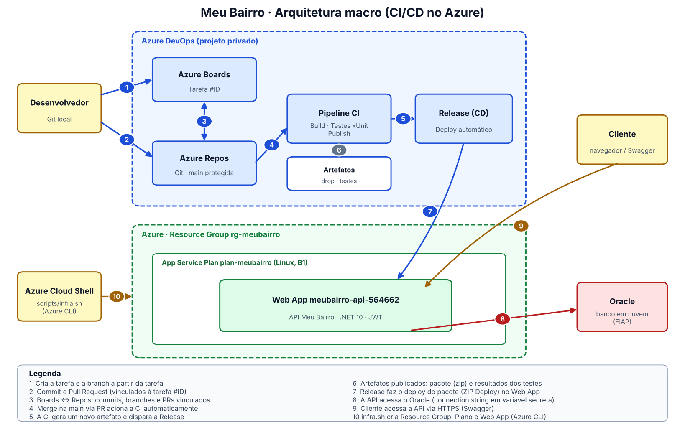

# Meu Bairro · API em nuvem com Azure DevOps

Projeto da Global Solution 2026/2 · DevOps Tools & Cloud Computing (FIAP).

André Bellandi Vital Rodrigues RM564662 – 2TDSPO
Gabriel Garcia Mayo Delatore RM563298 – 2TDSPO
Vitor Augusto Oliveira de Abreu RM564227 – 2TDSPI

## 1. Solução proposta

O **Meu Bairro** é uma API REST em **.NET 10** com autenticação **JWT** e documentação **Swagger**, desenvolvida na disciplina de Advanced Business Development with .NET. Nesta entrega, a mesma solução é publicada em nuvem com um fluxo completo de DevOps:

- **Infraestrutura como código**: os recursos do Azure são criados por script (Azure CLI).
- **Azure Boards**: o trabalho começa em uma tarefa, vinculada a branches, commits e Pull Requests.
- **Azure Repos**: código versionado em Git, com a `main` protegida por políticas de branch.
- **Azure Pipelines (CI)**: a cada merge na `main`, compila, executa os testes xUnit e publica os artefatos.
- **Azure Pipelines (Release)**: a cada novo artefato da CI, faz o deploy automático no Azure App Service.
- **Banco de dados Oracle** em nuvem, acessado pela API por connection string guardada em variável secreta.

## 2. Arquitetura



| # | Fluxo |
|---|-------|
| 1 | Cria a tarefa e a branch a partir da tarefa |
| 2 | Commit e Pull Request, vinculados à tarefa |
| 3 | Boards e Repos vinculados (commits, branches e PRs) |
| 4 | O merge na `main` via PR aciona a CI automaticamente |
| 5 | A CI gera um novo artefato e dispara a Release |
| 6 | Artefatos publicados: pacote (zip) e resultados dos testes |
| 7 | A Release faz o deploy (ZIP Deploy) no Web App |
| 8 | A API acessa o Oracle |
| 9 | O cliente acessa a API via HTTPS (Swagger) |
| 10 | O `infra.sh` cria os recursos no Azure (Azure CLI) |

## 3. Recursos criados em nuvem

Criados por `scripts/infra.sh` (Azure CLI, executado no Azure Cloud Shell):

| Recurso | Nome |
|---------|------|
| Resource Group | `rg-meubairro` |
| App Service Plan (Linux, B1) | `plan-meubairro` |
| Web App (.NET 10) | `meubairro-api-<RM>` |

O banco Oracle é um serviço externo à assinatura e o DDL dos objetos está em `scripts/script-bd.sql`.

## 4. Pipelines

### CI · `azure-pipeline.yml` (raiz do repositório)
- **Gatilho:** somente commit na `main`, ou seja, após o merge de uma PR (`pr: none`).
- **Etapas:** instalar .NET SDK → restore → build → testes xUnit → publish → gerar `startup.sh` → compactar o pacote.
- **Artefatos publicados:**
  - `drop`: `meubairro-api.zip`, o pacote da API.
  - `testes`: resultados dos testes (`.trx`). Os resultados também aparecem na aba *Tests* da pipeline.

### Release (Azure Pipelines → Releases)
- **Gatilho:** *Continuous deployment trigger* no artefato da CI (branch `main`). Cada novo artefato gera um release automaticamente.
- **Etapa:** task *Azure App Service deploy* publica o `meubairro-api.zip` no Web App Linux.

### Variáveis e segredos
Nenhuma senha ou chave fica no código. Os valores são definidos como variáveis da Release e entram no Web App como *App settings*:

| Variável da Release | Configuração no Web App | Observação |
|---------------------|-------------------------|------------|
| `JWT_SEGREDO` | `Jwt__Segredo` | variável secreta |
| `DB_CONNECTION` | `ConnectionStrings__Oracle` | variável secreta |

## 5. Políticas da branch `main`
- Pull Request obrigatório, com revisor obrigatório e revisor padrão (RM do autor).
- Vínculo obrigatório com Work Item.
- O autor pode aprovar a própria PR (simulação acadêmica).
- Não há build de validação na PR: a CI roda apenas depois do merge.

## 6. Estrutura do repositório

```
├── azure-pipeline.yml        # Pipeline de CI (YAML)
├── scripts/
│   ├── infra.sh              # Provisionamento (Azure CLI)
│   └── script-bd.sql         # DDL do banco
├── docs/
│   └── arquitetura.png       # Desenho da arquitetura
└── Meu-bairro-.NET-main/     # Código-fonte da solução (.NET)
```

## 7. Como executar o provisionamento

No Azure Cloud Shell (Bash):

```bash
git clone <URL do repositório no Azure Repos>
cd <repositório>
bash scripts/infra.sh <RM>
```

## 8. Acesso à API

- **Swagger:** `https://meubairro-api-<RM>.azurewebsites.net/swagger`
- A API usa Swagger, por isso o CRUD é exercitado por lá.

## 9. Tabelas do banco

Modelo relacional Oracle de zeladoria colaborativa: o cidadão registra um problema do bairro (solicitação), a equipe municipal acompanha o andamento e o cidadão avalia o atendimento. O DDL completo está em `scripts/script-bd.sql`.

| Tabela | Descrição | Relacionamentos |
|--------|-----------|-----------------|
| `enderecos` | Endereços (logradouro, bairro, cidade, estado, CEP e coordenadas) | Usada por `usuarios` e `solicitacoes` |
| `usuarios` | Cidadãos que usam o app (nome, e-mail único, senha, telefone, data de cadastro) | N:1 com `enderecos` |
| `funcionarios` | Equipe responsável (nome, setor, cargo, e-mail único, senha, telefone) | Atende `solicitacoes` e registra `andamentos` |
| `categorias` | Tipo do problema (nome único, descrição e prazo em dias) | 1:N com `solicitacoes` |
| `solicitacoes` | Problema reportado (título, descrição, status, prioridade, datas de abertura e conclusão) | N:1 com `usuarios`, `categorias`, `enderecos`; N:1 opcional com `funcionarios` |
| `andamentos` | Histórico de atualizações de uma solicitação | N:1 com `solicitacoes` e `funcionarios` |
| `anexos` | Fotos e evidências da solicitação (nome, tipo e URL) | N:1 com `solicitacoes` |
| `avaliacoes` | Nota de 1 a 5 e comentário do cidadão após a conclusão | 1:1 com `solicitacoes` |
